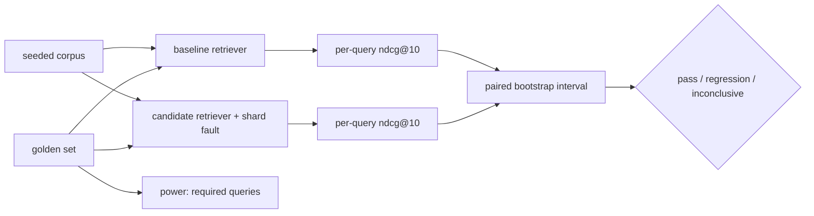
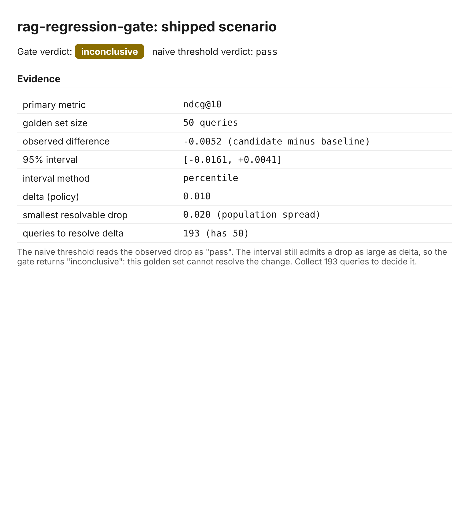

# rag-regression-gate

**A retrieval regression gate that refuses to call a change good or bad when the golden set is too small to tell.** It scores a RAG retriever on a golden set, then uses a paired bootstrap to report whether an observed drop is a real regression, a real pass, or beyond the resolution of the evidence.


## The question a golden set cannot answer

A regression gate in CI is almost always a threshold: the mean retrieval metric dropped by more than some amount, or it did not. That verdict is computable on any number of queries, which is the problem. A threshold on a small golden set has no model of how much its own mean would move if a different sample of queries had been drawn, so it cannot separate a real regression from sampling noise. It answers anyway, confidently, and ships the wrong verdict.

This tool supplies the missing model of variance. It answers three questions a fixed threshold cannot:

1. Is this drop larger than the noise, or is it the noise? (A paired bootstrap interval, not a point estimate.)
2. If the set cannot tell, how many queries would it take? (The sample-size arithmetic, printed.)
3. Is the gate itself even calibrated on this kind of data? (Measured under the null, and the answer changed the design.)

## The uncomfortable numbers

The shipped scenario is a candidate retriever carrying a real corrupted-shard fault: across the full query population it **carries a 0.016 drop** in ndcg@10. On the single **50-query golden set** a team happens to hold, the **measured drop is 0.005**, and the naive threshold reads that as a pass: it ships the regression. The gate reports a 95% interval of **[-0.016, 0.004]**, which still includes zero, and returns `inconclusive` instead.

That is not a cherry-picked seed. Across 200 golden sets at a true drop the size of the gate's own threshold, the naive verdict is a coin flip: it **passed it on 54.5%** of sets and **failed it on 45.5%**, decided entirely by which queries were drawn. The gate returns `inconclusive on 44.5%` of them rather than guessing.

And the gate had to earn the right to say any of this. Its first interval method, BCa, was not calibrated: under the null, over **400 null golden sets**, **BCa fired on 14%** of them at a **nominal 5%**, while the **percentile interval held at 5.8%**. The default was changed, and now the **gate fires on 5%** of the null. The whole story is [ADR 005](docs/adr/ADR-005-percentile-over-bca.md).

Every number in this README is re-measured by `tools/collect_metrics.py` and verified against this prose by `tools/check_numbers.py` in CI. The suite is **101 tests** at **100% of lines**.

## Quickstart

Prerequisites: Python 3.11 or newer.

```bash
pip install -e ".[dev]"

# The headline: the shipped candidate on 50 queries. Exits 2 (inconclusive).
ragscore gate

# How many queries would actually resolve the drop the policy cares about?
ragscore power

# Re-measure every published number and check it against the docs. No network.
make verify
```

`make verify` runs lint, the full suite, re-measures the experiments, and fails if any figure in this README has drifted from the code. It passes from a fresh clone with no network and no API key.

## What the gate returns, and why three verdicts

| verdict | exit | meaning |
| --- | --- | --- |
| pass | 0 | the interval excludes a drop as large as delta; any regression is below what the team cares about, and the sample was large enough to say so |
| regression | 1 | the interval lies entirely below zero; a drop is real at 95% |
| inconclusive | 2 | the interval still admits a delta-sized drop; this golden set cannot tell |

The split that matters is between exit 1 and exit 2: a regression is an answer, inconclusive is the tool reporting that the evidence is insufficient. A CI job that treats 2 as success ships on no evidence; one that treats it as failure blocks on no evidence. The honest response is more queries, and `ragscore power` prints how many. See [ADR 002](docs/adr/ADR-002-three-valued-gate.md).

## The calibration result

Under the null the candidate is the baseline retriever run a second time, so the true difference is zero and only run jitter separates the two score vectors. A 95% interval should then call a regression about 5% of the time.

| interval method | null false-positive rate |
| --- | --- |
| nominal | 5% |
| BCa | 14% |
| percentile | 5.8% |

BCa fired nearly three times as often as it promised, because the paired-difference vector is zero-inflated: most queries rank the relevant documents identically across two runs, so BCa's acceleration term is estimated from a jackknife of a near-constant vector and is unstable. The percentile interval estimates no acceleration and stays near nominal. The naive threshold, for contrast, **naive fired on 0%** of the null, which is a measured zero over 400 sets and so means below roughly 1 in 400, not a guarantee. That is the naive gate's one virtue: it is blind near the threshold rather than trigger-happy on jitter. Reproduce with `python experiments/exp01_calibration.py`.

## The resolution arithmetic

On the shipped candidate the per-query **difference spread of 0.050** in ndcg@10 means that, with a 50-query set, the smallest drop it can **resolve about 0.020** at 95% confidence and 80% power. The policy cares about a 0.01 drop, so to resolve it the set **needs 193 queries** and has 50. That gap, between the set a team holds and the set the claim needs, is the number this project exists to surface. Reproduce with `ragscore power` or `python experiments/exp02_resolution.py`.

## What it costs against what it buys

| choice | what it buys | what it costs |
| --- | --- | --- |
| percentile over BCa | calibration under the null (5.8% vs 14%) | slightly wider intervals, so marginally more queries for the same power |
| three-valued verdict | never ships a regression it cannot see | callers must decide what to do with inconclusive |
| synthetic corpus | every number reproducible offline with one command | absolute metric values are not realistic, only the statistics transfer |

## The bug the measurement found

The gate shipped with BCa, the textbook interval for a skewed statistic. It looked right in every spot check, because a spot check uses a visible effect and BCa is fine there. The calibration experiment, which looks at the null, is what exposed it: a 14% false-positive rate where 5% was promised. The fix was one line of default, the diagnosis was the zero-inflated difference vector, and the finding is pinned by a regression test so a later change that reaches for BCa again fails first. Full write-up in [ADR 005](docs/adr/ADR-005-percentile-over-bca.md).

## Architecture





## Evidence



The report above is generated by `python -m ragscore.report` and photographed by `tools/capture_screenshots.py`, which also fails if the verdict badge is not legible. The replay below is captured stdout paced by measured wall time, not a hand-typed recording; every command and its exit code are listed in `docs/video/manifest.json`.


## The corpus and its awkward cases

The corpus is 600 documents across 120 fine-grained topics (five documents each), which is what makes ndcg@10 sensitive to a corrupted shard: when the fault demotes one of a query's five relevant documents, it falls out of the top ten and the metric moves. The relevant set for a query is defined by topic membership, so relevance is an oracle rather than a judgement in doubt. The hard case the corpus deliberately contains is the null itself: two runs of one retriever that agree on most queries and disagree on a handful, which is the zero-inflated vector that broke BCa.

## What this cannot measure

This is the boundary, stated as its own section because it is the honest limit of the work.

- The retriever is TF-IDF over a synthetic corpus, not a real embedding model against a real vector database. The statistical layer (the bootstrap, the calibration, the three-valued verdict, the sample-size arithmetic) transfers unchanged to a real retriever, because it only ever sees per-query metric vectors. The absolute metric values, the exact difference spread, and therefore the exact required-sample-size numbers do not transfer; a real team re-measures their own spread, which `ragscore power` does. See [ADR 003](docs/adr/ADR-003-synthetic-corpus-boundary.md).
- Run jitter is a declared input, not a magnitude measured from a production system. Every experiment states the noise level it assumed. See [ADR 004](docs/adr/ADR-004-jitter-is-a-declared-input.md).
- The sample-size arithmetic uses a normal approximation for a paired mean. Near the boundary a bootstrap and the formula can disagree by a query or two.
- Nothing here establishes that a given embedding change helps or harms on a given production corpus. That is a claim about absolute quality, which no fixture can make. This tool makes the narrower, transferable claim: whether a difference is resolvable at a given sample size.

## Layout and reproduction

```
src/ragscore/     corpus, retrieval, metrics, bootstrap, power, gate, cli, report
experiments/      five experiments writing JSON to docs/experiments/
tools/            collect_metrics, check_numbers, render_diagrams, capture_screenshots
docs/adr/         five architecture decision records
policy.toml       every number that decides a verdict, with a comment per field
```

Exit codes: 0 pass, 1 regression, 2 inconclusive, 3 tool error. The 2-versus-1 distinction is the contract; do not collapse it.

Make targets: `make lint`, `make test`, `make receipts`, and `make verify` which runs all three. The number checker matches anchor phrases rather than bare digits, because a bare digit is found in a document that has gone stale around it; an anchor is a number plus a few words, and it is what keeps this README from drifting from the code. The checker is proved to work by breaking a figure on purpose, which is its own commit in the history.

## Tech stack

| technology | role here | why this one |
| --- | --- | --- |
| scikit-learn | TF-IDF vectoriser and cosine | real retrieval a reviewer can recompute, with no model download |
| numpy | resampling and metric vectors | the bootstrap is array arithmetic, and its RNG is version-stable |
| scipy.stats | normal quantiles for the power formula | only the quantiles, the test itself is the bootstrap |
| pandas | the per-query frame the report renders | the report is tabular and pandas renders it cleanly |

Decisions: [ADR 001](docs/adr/ADR-001-paired-query-bootstrap.md) paired query bootstrap, [ADR 002](docs/adr/ADR-002-three-valued-gate.md) three-valued gate, [ADR 003](docs/adr/ADR-003-synthetic-corpus-boundary.md) synthetic corpus boundary, [ADR 004](docs/adr/ADR-004-jitter-is-a-declared-input.md) jitter as a declared input, [ADR 005](docs/adr/ADR-005-percentile-over-bca.md) percentile over BCa.

Bootstrap resample count is fixed at **5000 resamples**, chosen by the convergence curve in `experiments/exp00_resamples.py`, not by habit.

## The Pivot and future work

Deliberately out of scope: a real embedding model and a live vector database. The trigger to add them is a team that needs absolute metric parity with production retrieval rather than relative regression detection, at which point the boundary in ADR 003 is the thing to cross.

- A studentized bootstrap, which can be better calibrated than the percentile on skewed data; the first metric to watch is the same null false-positive rate.
- Per-query relevance grades beyond binary, so ndcg uses graded gains; watch whether the difference spread shrinks.
- A sequential test, so a team can add queries and stop as soon as the verdict is resolved rather than fixing the size in advance.
- Multiple-metric control, so gating on ndcg, recall and mrr together does not inflate the false-positive rate; watch the joint null rate.

## License

MIT, see [LICENSE](LICENSE).
